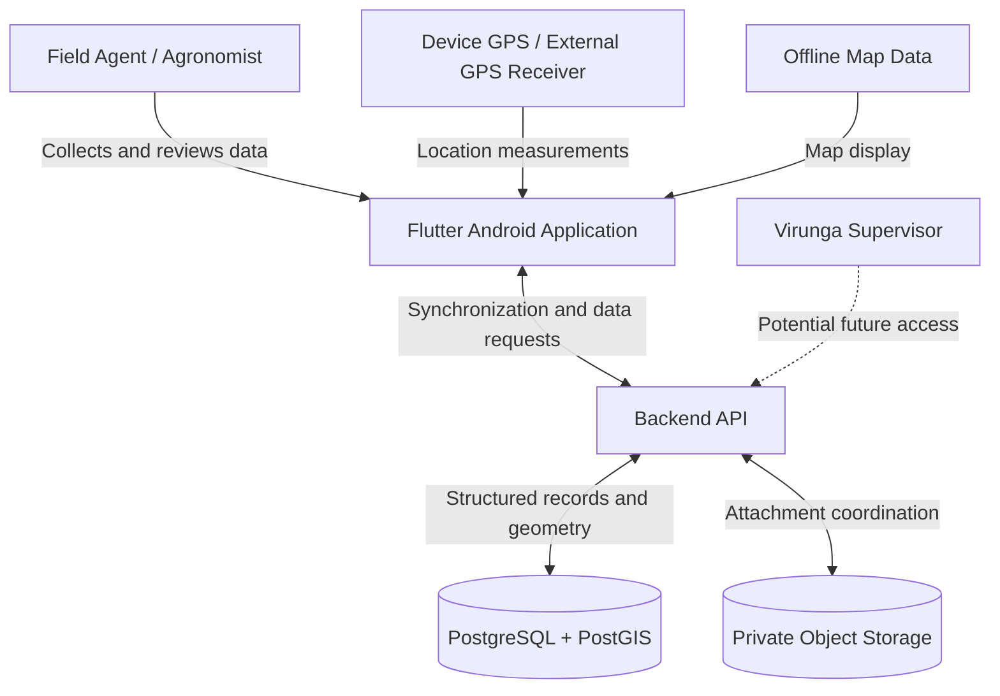
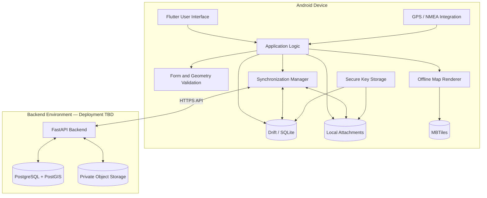

# Technical Design

> **Status:** Initial design – living document  
> **Last updated:** November 1, 2026  
> **Project:** Offline Field Data Collection App for Agricultural Traceability  
> **Partner:** Virunga Foundation

## 1\. Overview

The project aims to develop an offline-capable Android application for Virunga field agents to collect agricultural data. The application will support the registration of farmers and households, collection of field boundaries and access paths, and capture of supporting information such as photographs and signatures.

The application must function in areas with unreliable or unavailable internet connectivity. Collected data will be stored locally until it can be safely synchronized with a centralized backend.

The system follows an offline-first client-server architecture:

- **Mobile application:** Provides data collection, geographic tools, local validation, and offline persistence.  
- **Backend API:** Handles synchronization, server-side validation, and communication with centralized storage.  
- **Database:** Stores structured records and geographic information.  
- **Object storage:** Stores photographs and other file attachments.

Flutter is the confirmed mobile framework. The supporting technologies in this document reflect the team's current planned stack. Some integrations and infrastructure decisions remain subject to validation.

This document describes the intended architecture, major component responsibilities, and interfaces. It should be updated as implementation decisions are finalized.

## 2\. System Architecture

### 2.1 System context

The primary users are Virunga field agents and agronomists collecting agricultural information in the field. The application should accommodate users with limited experience using smartphones and GIS software.

The system interacts with the following actors and external components:

- **Field agents:** Register farmers and related information, collect geographic data, and synchronize records.  
- **Virunga supervisors:** May review and manage collected information through a future back-office application.  
- **Backend API:** Receives, validates, and returns application data.  
- **PostgreSQL/PostGIS:** Stores structured records and geographic information.  
- **Object storage:** Stores photographs and other attachments.  
- **GPS hardware:** Provides location information through the device or a supported external receiver.  
- **Offline map data:** Provides geographic context when network access is unavailable.

### 2.2 Context diagram

&nbsp;

The mobile application is the primary user-facing component. It must remain usable without a network connection.

The supervisor back-office is a stretch goal and is not a required dependency of the core mobile application.

### 2.3 Container architecture

&nbsp;

This diagram represents the intended architecture, not completed implementation.

### 2.4 Component responsibilities

**Mobile application**

The mobile application will be developed using Flutter and Dart. Its responsibilities include:

- Providing guided data-entry workflows.  
- Persisting records and attachments locally.  
- Collecting and displaying geographic information.  
- Performing local form and geometry validation.  
- Tracking pending synchronization operations.  
- Retaining local data until successful backend confirmation.

The application should separate presentation, application logic, domain rules, and data access. This will help keep business rules independent of the user interface and make individual components easier to test.

**Local persistence**

Drift with SQLite is the planned local database solution. It will store structured records, relationships, geographic information, version metadata, synchronization state, and references to attachments.

The application will use WKB for local geometry storage and convert geometry to GeoJSON at the API boundary.

**Geographic tools**

The planned mapping and location stack includes:

- `flutter_map` for map rendering.  
- MBTiles for offline map data.  
- Geolocator for device location.  
- NMEA-compatible external GPS receiver integration, subject to implementation and hardware validation.  
- A Dart JTS port for geometric operations and shape validation.

The application should support guided field-boundary collection, access-path collection, and local checks for invalid geometry. Required checks include polygon closure, self-intersection, and applicable overlap checks.

Area calculations must account for geographic coordinates rather than treating latitude and longitude as ordinary planar coordinates.

**Backend**

The backend is planned to use Python and FastAPI. It will provide the API used by the mobile application for authentication, synchronization, data retrieval, validation, and attachment coordination.

PostgreSQL with PostGIS will provide centralized structured and geographic storage. Private object storage will hold uploaded attachments.

## 3\. Technology and Data Design

### 3.1 Planned technology stack

Flutter is the confirmed mobile framework. The remaining technologies represent the team's current accepted direction, but their integration and suitability must be validated during implementation.

| Area | Planned technology | Responsibility |
| :---- | :---- | :---- |
| Mobile framework | Flutter | Android application |
| Language | Dart | Mobile application implementation |
| Local database | Drift / SQLite | Offline structured persistence |
| Local geometry | WKB | Local geometry representation |
| API geometry | GeoJSON | Geometry exchange |
| Database encryption | SQLite3 Multiple Ciphers | Local database encryption |
| Key storage | `flutter_secure_storage` | Secure storage of encryption keys |
| File encryption | `cryptography` | Attachment encryption |
| Geometry operations | Dart JTS port | Shape validation and geometric operations |
| Map rendering | `flutter_map` | Map visualization |
| Offline maps | MBTiles | Local map tile storage |
| Device location | Geolocator | Device GPS access |
| External GPS | NMEA receiver integration | External location data |
| Background work | Workmanager | Scheduled/deferred synchronization |
| Dynamic forms | Versioned JSON schemas | Data-driven form definitions |
| Backend | Python / FastAPI | API and server-side logic |
| Database | PostgreSQL / PostGIS | Centralized records and geometry |
| Object storage | Proposed AWS S3 | Attachment storage |
| CI/CD | GitHub Actions | Automated checks and builds |

The precise package versions and configurations should be maintained in the project's dependency and build files.

### 3.2 Data model

The application must support relationships between people, farmers, households, homes, fields, and associated information.

The target data design identifies several record types:

- **Person:** Individual identity and personal information.  
- **Farmer:** Agricultural information associated with a person.  
- **Household member:** Information about members of a farmer's household.  
- **Field:** Ownership, agricultural information, boundary geometry, and access path.  
- **Tree / Tree count:** Optional agricultural inventory information.  
- **Visit:** Registration or subsequent check-visit information.

The exact database schema and relationships should be documented as they are finalized.

Records created offline require stable identifiers that can be used both on the device and in the backend. UUIDs are the proposed approach.

Records should retain version information so the backend can detect changes made since a device last synchronized.

### 3.3 Geographic data representation

Geographic information uses different representations depending on where it is stored:

| Location | Representation |
| :---- | :---- |
| Mobile local database | WKB |
| API requests and responses | GeoJSON |
| Backend database | PostGIS geometry |

The API will use GeoJSON with WGS84 coordinates for geographic exchange. Conversion between local and API representations will occur at the synchronization boundary.

Geographic validation must account for the requirements of field collection, including valid polygons, self-intersections, and relevant overlap checks. Area calculation should use an appropriate geodesic method.

### 3.4 Dynamic forms

Versioned JSON schemas are the planned approach for data-driven forms.

The target design calls for form definitions to be managed as data rather than hard-coded into individual application screens. Each record should retain the form version used when it was collected.

The initial implementation may use a simpler form-authoring process, such as spreadsheet-based definitions converted into JSON. A visual form builder is a stretch goal and is not required for the core architecture.

## 4\. Interfaces and Synchronization

### 4.1 Mobile-to-backend interface

The mobile application will communicate with the backend over HTTPS.

The API is expected to support the following operations:

| Operation | Responsibility |
| :---- | :---- |
| Authentication | Establish user identity and permissions |
| Push changes | Submit new and modified records |
| Pull changes | Retrieve server-side changes since the previous synchronization |
| Attachment upload | Coordinate secure file uploads |
| Attachment retrieval | Retrieve authorized files |
| Form retrieval | Obtain available versioned form definitions |

Structured data will use JSON. Geographic information will use GeoJSON.

The backend should document its API using OpenAPI. Exact paths, methods, schemas, and error formats must be finalized before dependent mobile and backend functionality is implemented independently.

### 4.2 Synchronization model

Synchronization will use a push/pull approach.

**Push changes**

1. The application identifies records with pending changes.  
2. It submits records with their UUIDs and version information, including the base version where applicable.  
3. The backend validates each submitted record.  
4. The backend processes records and returns an outcome for each one.  
5. The application updates its local synchronization state.

The expected outcomes are:

- **Accepted:** The submitted change was successfully stored.  
- **Conflict:** The submitted change cannot be safely applied because the server-side record has changed.  
- **Rejected:** The submitted change failed validation or authorization.

A failed or unresolved operation must not cause the mobile application to discard its local record.

**Pull changes**

1. The application sends its most recent synchronization token.  
2. The backend identifies changes available since that token.  
3. The backend returns the changes and an updated token.  
4. The application applies the returned changes locally.

The synchronization token allows the application to continue from its previous successful synchronization point.

### 4.3 Reliability and conflict handling

Synchronization must tolerate interrupted network connections and safely support retries.

The backend should use stable record identifiers and idempotent processing so that retrying a request does not create duplicate records.

The mobile application must not assume that a request failed simply because it did not receive a response. The backend may have processed the request before the connection was interrupted.

Conflicting changes must not be silently overwritten. The system should preserve the local version and provide enough information for the conflict to be resolved.

The exact user-facing conflict-resolution workflow remains to be finalized.

### 4.4 Attachment handling

Photographs and other attachments will be stored separately from structured database records.

The intended workflow is:

1. The application requests authorization to upload an attachment.  
2. The backend provides a temporary upload mechanism.  
3. The application uploads the file.  
4. The backend confirms receipt and associates the attachment with its record.  
5. The application marks the attachment as synchronized only after confirmation.

The upload process should support recovery from interrupted connections. Resumable uploads are a behavior to investigate and validate.

## 5\. Security and Deployment

### 5.1 Security and privacy

The application handles personal information and geographic data. Security must be considered across local storage, communication, backend access, and attachment handling.

The planned security approach includes:

- HTTPS for communication between the application and backend.  
- Local database encryption using SQLite3 Multiple Ciphers.  
- Secure storage of database encryption keys using `flutter_secure_storage`.  
- Attachment encryption using the proposed `cryptography` package.  
- Private backend object storage.  
- Encryption at rest for backend data and files.  
- Authenticated API access and role-/zone-scoped authorization.  
- No secrets or credentials committed to the repository.

The encryption implementation, key lifecycle, authentication provider, and authorization model require further technical decisions and validation.

The application should avoid unintentionally exposing photographs through the device's public photo gallery.

Consent information and signatures should be associated with the relevant records and retained with appropriate version information. Access and change records should support auditing.

**Development data:** The student development environment must use synthetic data only. Real farmer data must not be introduced into student-controlled environments without explicit authorization and appropriate agreement with Virunga.

### 5.2 Mobile deployment

The initial delivery target is Android. iOS is outside the current project scope.

The application will be built and distributed as an APK for testing and demonstration, subject to agreement with Virunga.

### 5.3 Backend deployment

AWS is the proposed backend environment. The target architecture identifies the following services:

| Responsibility | Proposed AWS service |
| :---- | :---- |
| API entry point / hosting | API Gateway with Lambda, or containers on ECS |
| Structured and geographic storage | RDS for PostgreSQL with PostGIS |
| Attachment storage | Private S3 bucket |
| Authentication and roles | Cognito |
| Backups and logging | Appropriate AWS backup and logging services |

These are proposed services, not finalized infrastructure decisions.

The team has not yet decided whether to use a team-owned AWS environment or a Virunga-provided environment. This decision affects account ownership, permissions, costs, deployment, and long-term maintenance.

The backend architecture should remain independent of that ownership decision.

The target design calls for separated test, staging, and production environments. Student development and testing must use synthetic data. Production deployment and any use of real partner data require explicit agreement with Virunga.

Infrastructure as code using AWS CDK or Terraform may be used to support reproducible deployment. The tool has not been selected.

### 5.4 CI and testing

GitHub Actions will provide automated checks and build validation.

The mobile pipeline should include Flutter analysis, formatting checks, automated tests, and Android builds. Dependency and license checks are also planned.

The backend pipeline should include corresponding Python checks and tests once backend development begins.

Testing should pay particular attention to offline persistence, geometry validation, synchronization retries, idempotency, conflict detection, interrupted uploads, and authorization boundaries.

The repository is currently in its initial setup stage. The application skeleton and CI pipeline are among the first implementation tasks. The architecture in this document describes the intended system rather than completed functionality.

## 6\. Open Decisions and Technical Investigations

The following decisions remain open and should be resolved through technical investigation or discussion with Virunga.

| Decision / question | Reason |
| :---- | :---- |
| AWS account ownership | Determines infrastructure ownership, permissions, and deployment responsibilities |
| Backend hosting model | Lambda versus ECS or another suitable hosting approach |
| Authentication provider and role model | Determines identity management and data access |
| Android versions and device models | Affects compatibility and field testing |
| External GPS receiver compatibility | Requires validation of Bluetooth and NMEA integration |
| GPS accuracy thresholds | Affects location acceptance and boundary validation |
| Geometry and overlap rules | Determines local and server-side validation behavior |
| Offline map coverage and package size | Affects storage and map distribution |
| Conflict-resolution workflow | Determines how users handle concurrent changes |
| Form distribution and updates | Determines how versioned schemas reach devices |
| Consent requirements and refusal workflow | Affects forms and data retention |
| Data retention policy | Affects local cleanup and backend storage |
| Expected data and attachment volumes | Informs storage and synchronization design |
| Supervisor back-office scope | Determines whether and when the stretch goal is implemented |

The team should also investigate:

- Whether the proposed geometry library supports all required validation operations.  
- Whether the proposed encryption approach integrates correctly with Drift and SQLite.  
- How offline MBTiles packages will be generated and consumed by the mapping implementation.  
- The battery and performance implications of GPS tracking and polygon geofencing.  
- How synchronization behaves on very weak networks and after interrupted uploads.

Major architectural decisions should be recorded in separate Architecture Decision Records (ADRs), including the rationale and trade-offs.

## References

- **Field Data Collection App Target Design (To Be), October 8, 2026:** Product workflows, field constraints, functional priorities, and target system behavior.  
- **Flutter Supported Tech Stack Proposal:** Proposed Flutter-based technology stack.  
- **Capstone Technical Design Guide:** Architecture documentation expectations.  
- **Repository Checkpoints Assignment:** Documentation and deployment-target requirements.

This document is a living architecture reference. It should be updated as implementation details are validated, interfaces are finalized, and architectural decisions are made.

&nbsp;

---
gdoc_comments:
  c1:
    status: RESOLVED
    token: AX5pRSljzGaC4Wp9SkKNUvj5keh1PvdE7poUs4l7wczJKfjp39iS7Qf43-BxYuAddubnUrdnn5e5dQ0gViZe2-EnIm2EIXmzQQuLZH0VwB6UcUZvy4gwKTy7LmqaUXc43exal__vY3YQMLGeWaIUucHoFua95FTNBlD_wiIVAeNjux5xV6uujYgtDMHcsX14ihFYBLX8cKHQKhGQ1ctpw9MQUjzLf6URD6EcxaezzRN_UMVqx3kWAOmOMGxF7i-rugwPwH2jjtwxPbNdEQJNHbuOR_s8bxu3fuvsDNvCTDWwmmqbAlKnBlhNZtpxhldrXieQkL1rgyTQe8wjk57EVBC6YslSyL6JMYgbCb8j30Qep5YMjAzA6oUX8yZumVrQrfNlU-9H-9FFznWEXsG4zm9tr7EIevr0NX2yjH-C42X_wjNqJExR5qeTVoIDySXyiUipa_phokp7TuGUl3zLOrG91mD9NbXul8U3dj7VuXCdoJfCI_F5P5L3H4Z6BFm6BixBJsYPwNMwgaBBkFOkeqX1ISgh1g
    head:
      author: Sophia Scherer
      time: '2026-11-02T04:48:21.980Z'
      body: I kind of combined the spec document they gave us at the start with our
        tech proposal. Let me know if you&#39;d like to see any changes :)
      quote: esign
    replies:
    - author: Sophia Scherer
      time: '2026-11-02T06:07:00.937Z'
      action: RESOLVE
---
